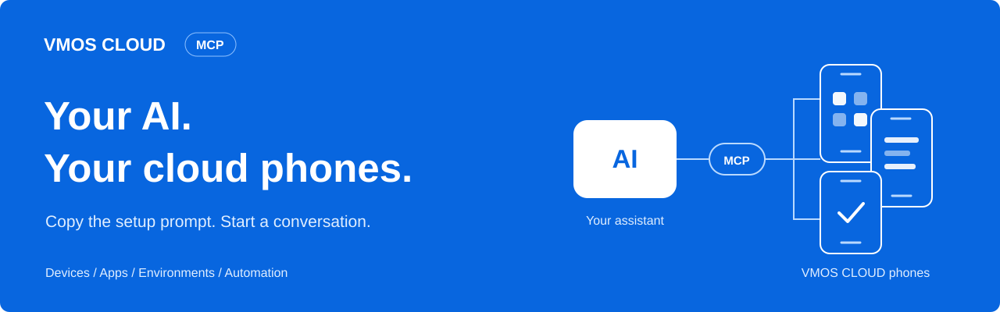

**English** · [简体中文](README.zh-CN.md)

# VMOS CLOUD MCP

**Manage your cloud phones through a conversation with your AI assistant.**

Find devices, configure environments, install apps, inspect screenshots, and follow automation tasks. VMOS CLOUD MCP connects your AI assistant to cloud phone tools. Describe the task, let your assistant call the tools, and review the actual results.

**[Connect MCP](https://cloud.vmoscloud.com/mcp)** · [Visit VMOS CLOUD](https://www.vmoscloud.com) · [API documentation](https://cloud.vmoscloud.com/vmoscloud/doc/en/server/OpenAPI.html)

## Copy the setup prompt. Connect your AI.

Your setup prompt is ready in the VMOS CLOUD console, with installation instructions and your current account configuration included.

1. **Open the connection page.** Sign in to [VMOS CLOUD](https://cloud.vmoscloud.com/mcp) and open **Automation + AI → MCP connection**.
2. **Copy the setup prompt.** Click the copy button to get the complete instructions for your account.
3. **Paste it into your AI assistant.** Use a local AI client that can access files, run commands, and connect to local MCP servers. Approve installation and connection steps when requested.

Your assistant will check the installation, configure your account, and query your cloud phones. Compare the first device IDs, names, and statuses with the console. MCP availability depends on the tools actually loaded in your client.

> The setup prompt contains your account's API credentials. Share it only with an AI assistant you trust. Never publish it in a repository, issue, or public screenshot. Initial setup only queries devices; it does not purchase or modify cloud phones.

## Start with one request

After connecting, send this to your assistant:

```text
List all my cloud phones in a table with their IDs, names, and statuses.
Read every page of results. Only query; do not purchase or change anything.
If there are no devices, say so clearly.
```

**What to expect:** The devices actually returned by your account, or an explicit empty result. If the query fails, your assistant should explain the problem instead of inventing devices.

## What you can ask your AI to do

| Use case | Tasks you can request |
| --- | --- |
| Find devices | List cloud phones and inspect their details and current state |
| Configure environments | Set proxies, languages, and time zones on selected devices, then verify the results |
| Manage apps | Inspect installed apps, install apps on selected devices, or open an app |
| Inspect and interact with screens | Retrieve screenshots; analyze images, tap, and enter text when the client has the required capabilities |
| Run automation | Find available templates, submit tasks, and follow their progress |
| Review batch results | Summarize successful, failed, and incomplete operations for each device |

Availability depends on account permissions, device state, app sources, and your AI client's tools. The requests below are examples you can copy, not recorded execution results.

## Requests to try

### Prepare two test devices

```text
Help me select two test cloud phones and set their language to English
and their time zone to Los Angeles. Show me the devices and proposed
settings first. Wait for my confirmation, apply them, and verify the
effective settings. If a proxy is needed, ask me for its details.
```

**Ask for:** The selected devices, applied settings, and verification results for each device.

### Install apps across devices

```text
Help me install apps on selected cloud phones. Ask me for the devices,
app names, and installation sources first. Check installed apps and skip
those already present. Wait for my confirmation before installing.
Track the same submitted task, then check the installed apps again.
Summarize installed, skipped, and failed items by device. Do not submit
an unfinished task again.
```

**Ask for:** Results by device and app, including reasons for failures.

### Inspect an app's current screen

```text
Ask me which cloud phone and app to inspect, then open the app and return
a current screenshot. Ask before powering on a device. Describe only
what the screenshot shows, and say if you cannot interpret it.
If sign-in is required, pause so I can enter my password and verification
code directly on the cloud phone.
```

**Ask for:** A current screenshot or image link, with an explanation grounded in the image.

### Run an existing automation task

```text
List the automation templates available to my account, explain them,
and help me choose one. Confirm the target devices and required parameters
before running it. Track the same task and summarize the results for each
device. If waiting times out, keep the task ID and report its current
status instead of submitting it again.
```

**Ask for:** The task ID, execution status, device results, and reasons for incomplete work.

Find more requests on the [MCP connection page](https://cloud.vmoscloud.com/mcp).

## Before you connect

- **VMOS CLOUD account:** Access to the MCP connection page and the required API permissions.
- **Local AI client:** Access to local files, command execution, and local MCP servers. A chat window without local tools cannot install the program from a prompt alone.
- **Computer:** Packages are available for Windows x64 and macOS 13+ on Apple Silicon and Intel. Check the connection page for the current version. Current packages are unsigned release candidates; native Mac installation acceptance is still pending.

See the [connection page](https://cloud.vmoscloud.com/mcp) for client choices and operating modes. Your operating system or AI client may ask you to approve an action.

## FAQ

### Do I need to download a program or edit configuration files myself?

The recommended flow is to copy the console's setup prompt into your AI assistant. It includes download sources and configuration steps for the assistant to carry out. Follow any instructions if permissions or system checks prevent it from continuing.

### Why isn't the complete setup prompt published here?

The console adds your current account configuration to the prompt. Sign in and copy it there to connect the correct account. This repository contains public product information and usage examples.

### Do I need to repeat setup for every conversation?

The local program reuses saved credentials after setup. New conversations still need access to the configured MCP server. Copy a new setup prompt when changing computers, switching accounts, or rotating keys.

### Does a successful device query mean MCP is connected?

Not necessarily. Setup may query devices through the local program first. Ask your assistant to confirm that VMOS CLOUD MCP tools are loaded in the current client. Follow the client's instructions if the session needs to reload.

### Can it handle sign-in and every in-app action automatically?

Enter passwords and verification codes yourself on the cloud phone. Image interpretation and in-app actions depend on your client, available tools, and the actual screen. Automation requires an executable template available to your account. Check the real results at each step.

### Are there usage costs?

Cloud phones and related services follow VMOS CLOUD's current plans and billing rules. Your AI provider sets its own charges. Confirm the plan, price, and billing period before purchasing or renewing.

---

**[Open VMOS CLOUD and connect your AI](https://cloud.vmoscloud.com/mcp)**

This repository provides product information and setup guidance for VMOS CLOUD MCP. For account or connection help, use the support entry on the [VMOS CLOUD website](https://www.vmoscloud.com).
