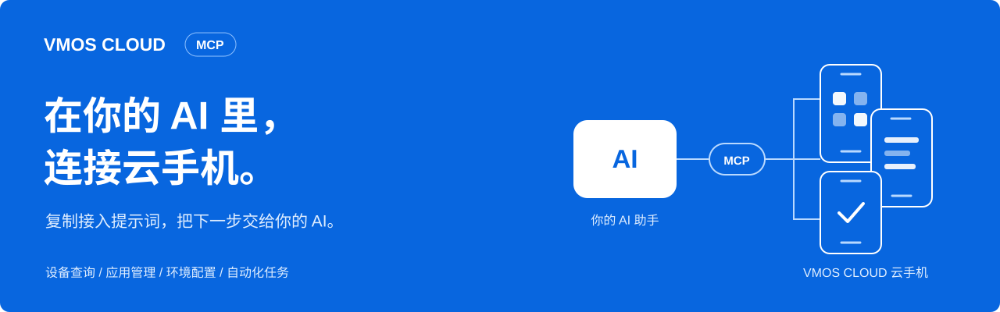

[English](README.md) · **简体中文**

# VMOS CLOUD MCP

**用对话管理云手机，让你的 AI 助手帮你完成操作。**

查询设备、配置环境、安装应用、查看截图、跟进自动化任务。VMOS CLOUD MCP 将云手机能力接入你的 AI 助手：你描述需求，AI 调用工具执行，并根据实际返回结果向你反馈。

**[开始连接 MCP](https://cloud.vmoscloud.com/mcp)** · [访问官网](https://www.vmoscloud.com) · [查看 API 文档](https://cloud.vmoscloud.com/vmoscloud/doc/zh/server/OpenAPI.html)

## 复制提示词，开始连接

接入提示词已经准备在 VMOS CLOUD 控制台里，包含安装说明和当前账号配置。

1. **打开连接页面。** 登录 [VMOS CLOUD](https://cloud.vmoscloud.com/mcp)，进入「自动化 + AI → MCP连接」。
2. **复制接入提示词。** 点击「复制接入提示词」，获取当前账号的完整接入内容。
3. **粘贴给你的 AI。** 在能操作本机文件、执行命令并支持本地 MCP 的 AI 客户端中发送提示词，按需允许安装和连接操作。

AI 会根据提示词检查安装、配置账号并查询云手机。首次返回列表后，请与控制台核对设备编号、名称和状态；MCP 是否已加载，以客户端实际提供的工具为准。

> 接入提示词包含当前账号的 API 密钥，只粘贴给你信任的 AI 助手。不要发布到 GitHub、Issue 或公开截图中。首次接入只查询设备，不购买或修改云手机。

## 从一句话开始

连接后，把下面这句话发给 AI：

```text
请用表格列出我的全部云手机，包含编号、名称和状态，读取所有分页。
只查询，不购买或修改。列表为空时请明确说明。
```

**你应当得到：** 实际查询到的设备列表，或明确的空列表说明。若查询失败，AI 应说明原因，而不是生成示例设备。

## 你可以让 AI 做什么

| 场景 | 可以提出的任务 |
| --- | --- |
| 设备查询 | 列出云手机，查看设备信息与运行状态 |
| 环境配置 | 为指定云手机设置代理、语言和时区，并检查结果 |
| 应用管理 | 查看已安装应用，为选定设备安装或打开应用 |
| 屏幕查看与交互 | 获取截图，在客户端具备相应能力时进行画面分析、触控和文字输入 |
| 自动化任务 | 查询账号可用的模板，提交任务并跟进执行状态 |
| 批量结果核对 | 汇总各台设备的操作结果，区分成功、失败和未完成 |

具体可用功能取决于账号权限、设备状态、应用来源以及 AI 客户端提供的工具。下面的内容是可复制的请求示例，不是预先执行的结果。

## 接入后，你可以这样说

### 配置两台测试机

```text
帮我选择两台测试云手机，设置为英语和洛杉矶时区。
先列出目标设备及拟使用的配置，等我确认后执行，再检查实际生效结果。
如果需要代理，先向我询问代理信息。
```

**请 AI 返回：** 目标设备、实际使用的配置、逐台检查结果。

### 批量安装应用

```text
帮我给选定的云手机安装应用，先问我目标设备、应用名称和安装来源。
检查已安装列表，已安装的跳过；等我确认后再安装。
提交后持续查询同一个任务，完成后再次核对已安装列表。
最后按设备汇总安装、跳过和失败的结果，不要重复提交未完成的任务。
```

**请 AI 返回：** 按设备和应用整理的结果表，以及失败原因。

### 查看应用当前画面

```text
先问我要检查哪台云手机、哪个应用，再打开应用并返回当前截图。
如果需要开机，先征得我同意。仅根据截图说明当前画面；无法识别时明确说明。
如果需要登录，停下来让我在云手机里输入密码和验证码。
```

**请 AI 返回：** 当前截图或图片链接，以及有画面依据的说明。

### 执行已有自动化任务

```text
列出我账号可用的自动化模板并解释用途，帮我选择一个。
先确认目标设备和必要参数再执行，持续查询同一个任务并汇总各设备结果。
如果等待超时，保留任务编号并说明当前状态，不要重复提交。
```

**请 AI 返回：** 任务编号、执行状态、各设备结果与未完成原因。

更多示例可以在 [MCP 连接页面](https://cloud.vmoscloud.com/mcp) 查看和复制。

## 接入前准备

- **VMOS CLOUD 账号：** 能访问控制台的 MCP 连接页面，并具有相应 API 权限。
- **本机 AI 客户端：** 能读写本机文件、执行命令并连接本地 MCP。只有普通聊天能力的窗口不能仅凭提示词安装程序。
- **电脑环境：** 当前提供 Windows x64、macOS 13+ Apple Silicon 和 Intel 安装包；具体版本以连接页面为准。当前包为未签名候选版，Mac 真机安装验收尚待完成。

客户端选择和操作模式见 [连接页面](https://cloud.vmoscloud.com/mcp)。系统或客户端要求的授权仍需要你确认。

## 常见问题

### 需要自己下载程序或编辑配置吗？

按推荐流程，复制控制台的接入提示词给 AI 即可。提示词包含下载来源和配置步骤，由有本机操作能力的 AI 完成。若权限或系统检查阻止继续，按实际提示处理。

### 为什么不在 GitHub 直接放完整接入提示词？

控制台会把当前账号配置加入提示词。请登录后复制，确保连接的是自己的账号。这里提供的是公开介绍和使用示例。

### 每次对话都要重新接入吗？

配置完成后，本机程序会复用保存的凭据；新对话仍需能够访问已配置的 MCP。换电脑、切换账号或更换密钥后，请回到控制台重新复制接入提示词。

### AI 返回了设备列表，就代表 MCP 已连接吗？

不一定。接入流程可能先用本机程序完成查询。请让 AI 确认当前客户端是否已加载 VMOS CLOUD MCP 工具；如需重新加载会话，按客户端提示操作。

### 能自动完成登录和所有应用内操作吗？

密码和验证码由你在云手机中输入。画面分析与应用内操作还取决于客户端、可用工具和实际界面；自动化任务需要账号下已有可执行模板。以每一步实际返回的结果为准。

### 使用会产生费用吗？

云手机和相关服务按 VMOS CLOUD 当前套餐与计费规则收费。AI 客户端的费用由其提供方决定；购买或续费前请确认套餐、价格和计费周期。

---

**[前往 VMOS CLOUD，连接你的 AI](https://cloud.vmoscloud.com/mcp)**

本仓库提供 VMOS CLOUD MCP 的产品介绍与接入指南。遇到账号或连接问题，请通过 [VMOS CLOUD 官网](https://www.vmoscloud.com) 的客服入口联系。
